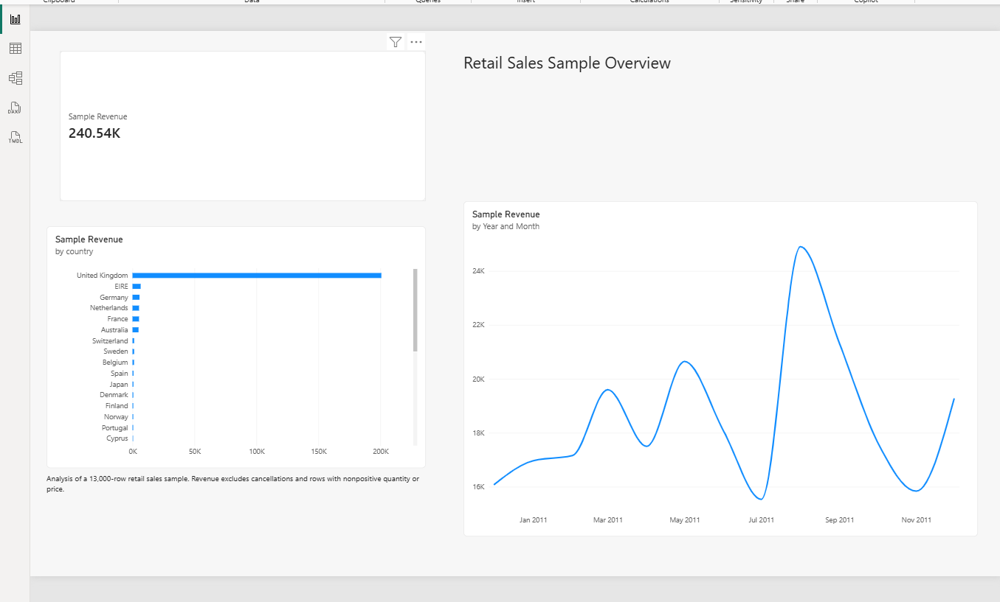

# Retail Sales Sample Dashboard

Power BI dashboard built from a 13,000-row retail sales sample, with SQL used to check and rank the results.

## What I did

- Cleaned the data in Power Query: removed 266 invalid rows, including 205 cancellations and rows with a nonpositive quantity or unit price, leaving 12,734 sales lines.
- Built DAX measures for revenue (quantity × unit price) and three dashboard views: total revenue, revenue by month, and revenue by country.
- Used SQL to rank products and countries by revenue.

## What I found

- The UK accounted for 83.5% of revenue in the cleaned sample.
- The SQL product ranking showed "postage" as a top seller. It's a shipping charge, not a product, so I excluded it from the product analysis.

## Files

- `Retail Sales Sample Dashboard.pbix`: the Power BI file
- `RetailPractice.sql`: SQL queries
- `retail_practice_13000.csv`: the raw sample
- `image.png`: dashboard screenshot

## Note

The figures describe this sample and should not be treated as totals for the full retail dataset.
